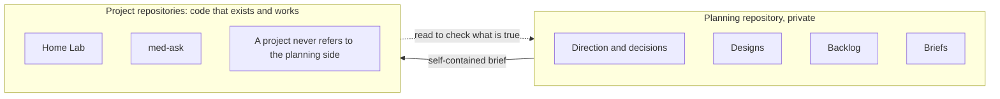
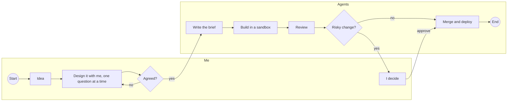

# Aleix Moreno Telesforo

**I design and build AI systems, and I use AI agents to build them.**
I came to technology from operations and then product.

[aleixmorenotelesforo.com](https://aleixmorenotelesforo.com) ·
[LinkedIn](https://linkedin.com/in/aleix-moreno-telesforo) ·
[Email](mailto:hello@aleixmorenotelesforo.com)

---

## What I am exploring

> How far can AI agents take software development on their own (safely, cheaply and in a way I
> can measure), and where does a human still add the most value?

1. **Capability where it pays.** Which work needs a frontier model, and which can a small or local
   model do just as well? *I measure models on my own past work, not on public benchmarks.*
2. **Autonomy that is safe by design.** How much can agents plan, merge and deploy without me?
   *Human approval is sized to what a mistake would cost. It is not given to every step.*
3. **Context, not prompts.** How does a system prepare what an agent needs to know, so that each
   agent starts small and focused? *I keep strategy apart from execution, and I hand over each
   piece of work as a self-contained brief.*
4. **The human's new role.** When agents write the code, what is my job? *I work as architect,
   decision maker and reviewer, and I watch where my time actually goes.*

## How I work: two levels

The planning repository holds what I intend and why. The project repositories hold only what
works. Only a brief crosses from one side to the other, so each agent gets exactly the context it
needs. Any session can restart from the repository alone.

The full process, with the platform that runs it:
[homelab-v2](https://github.com/TelesforoAleix/homelab-v2).

## Projects

- **[Home Lab](https://github.com/TelesforoAleix/homelab-v2):** a self-hosted applied-AI platform.
  It routes each request by purpose across hosted and local models, and runs coding agents in
  sandboxes. Its development system, Factory, plans, builds, reviews and deploys the platform with
  AI agents (Factory is private for now). About 360 slices of work were delivered this way since
  September 2026.
- **[med-ask](https://github.com/TelesforoAleix/med-ask):** search over 13 medical textbooks (about
  12,500 pages) for a medical student. It returns the original passages with book and page, and
  keeps the generated answer apart from the sources.
- **[Practical Quantum Advantage in Finance](https://github.com/TelesforoAleix/quantum-finance):**
  my MSc thesis. An AI-supported review of 777 papers with several LLMs. None of the 13 best
  candidates gives a practical advantage once the cost of loading data is counted.
- **[Business Central Manufacturing Videos](https://www.youtube.com/playlist?list=PLEyIZHETM3k4)
  and [ClickReplay](https://github.com/TelesforoAleix/ClickReplay):** six tutorial videos that I
  made at Microsoft with a GenAI toolchain (Copilot agents, the Microsoft Learn MCP server). ClickReplay is
  the small public tool that records and replays the demo input.
